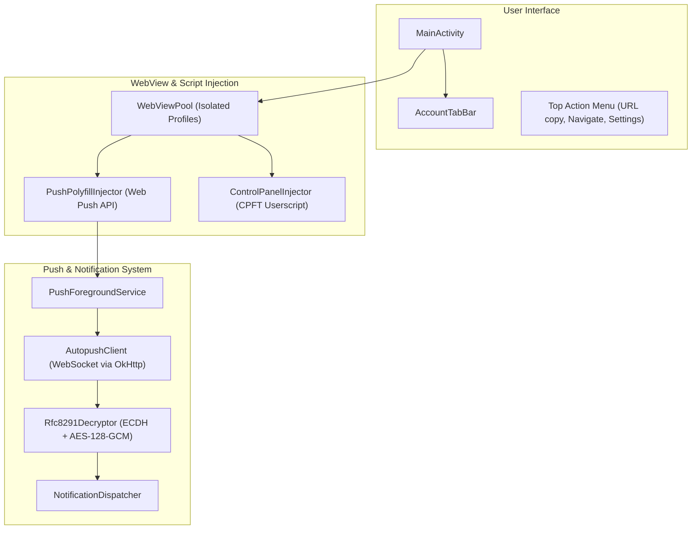

# PolyTwi

PolyTwi is a lightweight, privacy-focused multi-account Android PWA wrapper for X (formerly Twitter). It brings full Web Push notification capabilities, isolated multi-account support, and [Control Panel for Twitter](https://github.com/insin/control-panel-for-twitter) enhancements into a native Android experience—without relying on Google Play Services or Firebase Cloud Messaging.

---

## ✨ Features

- **👥 Multi-Account Isolation**
  - Uses modern Android WebView profile separation to isolate cookies, cache, and local storage per account.
  - Easily switch between accounts via the top/bottom tab bar.
  - Add, rename, or delete account profiles seamlessly.

- **🔔 Native Web Push without Google Play Services**
  - Built-in Web Push API polyfill (`PushManager`, `ServiceWorkerRegistration`, `Notification`).
  - Connects to Mozilla Autopush endpoints over WebSocket.
  - Decrypts RFC 8291 / RFC 8188 (ECE) push payloads (ECDH P-256 + HKDF + AES-128-GCM) on-device using BouncyCastle.
  - Full support for X's push notifications without requiring GMS / Google Play Services.

- **🛠️ Control Panel for Twitter Integration**
  - Bundled with [Control Panel for Twitter](https://github.com/insin/control-panel-for-twitter) to customize your timeline, remove algorithmic distractions, and streamline UI.
  - Safe update checking via GitHub Releases API with user confirmation dialogs and manual check options.

- **🔋 Battery & Resource Optimized**
  - Foreground Service runs under a low-importance notification channel (`IMPORTANCE_MIN`) which can be hidden in Android settings without affecting push reception.
  - Per-account high-importance notification channels for incoming X alerts.
  - Tuned WebSocket ping interval (90s) and transient, short-lived partial WakeLocks (released immediately upon notification dispatch).

- **🌐 PWA & Deep Linking Enhancements**
  - Handles `x.com`, `twitter.com`, and `mobile.twitter.com` links.
  - Displays an account picker when opening links if multiple accounts are configured.
  - Quick action menu: Copy current URL, navigate to a custom URL (with clipboard auto-detection), and reload.

---

## 🏗️ Architecture



- **[`MainActivity`](app/src/main/java/net/kgtkr/polytwi/MainActivity.kt)**: Manages account tabs, navigation lifecycle, deep links, and UI dialogs.
- **[`WebViewPool`](app/src/main/java/net/kgtkr/polytwi/webview/WebViewPool.kt)**: Handles WebView instances and isolated storage profiles.
- **[`PushPolyfillInjector`](app/src/main/java/net/kgtkr/polytwi/injector/PushPolyfillInjector.kt)**: Injects the JavaScript bridge implementing W3C Push API specifications.
- **[`AutopushClient`](app/src/main/java/net/kgtkr/polytwi/push/AutopushClient.kt)**: Maintains long-lived WebSocket connections to Mozilla Autopush.
- **[`Rfc8291Decryptor`](app/src/main/java/net/kgtkr/polytwi/crypto/Rfc8291Decryptor.kt)**: On-device decryption of encrypted web push payloads.

---

## 🚀 Building & Development

### Using Nix (Recommended)

This project provides a reproducible development environment via [Nix Flakes](flake.nix) containing Android SDK 35 and OpenJDK 17.

```bash
# Build debug APK
nix develop -c gradle assembleDebug

# Build release APK (unsigned)
nix develop -c gradle assembleRelease
```

The compiled APK will be located at:
```
app/build/outputs/apk/debug/app-debug.apk
```

### Manual Setup (Without Nix)

Prerequisites:
- Android SDK (API Level 35)
- Android SDK Build-Tools 35.0.0
- OpenJDK 17

```bash
./gradlew assembleDebug
```

---

## 📜 Permissions

| Permission | Purpose |
| :--- | :--- |
| `INTERNET` | Loading X web interface and communicating with Autopush WebSocket |
| `POST_NOTIFICATIONS` | Displaying incoming push notifications (Android 13+) |
| `FOREGROUND_SERVICE` | Maintaining push connection when app is backgrounded |
| `FOREGROUND_SERVICE_REMOTE_MESSAGING` | Android 14+ foreground service classification for push messaging |
| `RECEIVE_BOOT_COMPLETED` | Restarting the push service on device reboot |
| `WAKE_LOCK` | Briefly waking the CPU during notification payload decryption and dispatch |

---

## ⚖️ Disclaimer

PolyTwi is an independent open-source project and is not affiliated, associated, authorized, endorsed by, or in any way officially connected with X Corp., Twitter, or any of their subsidiaries or affiliates.
